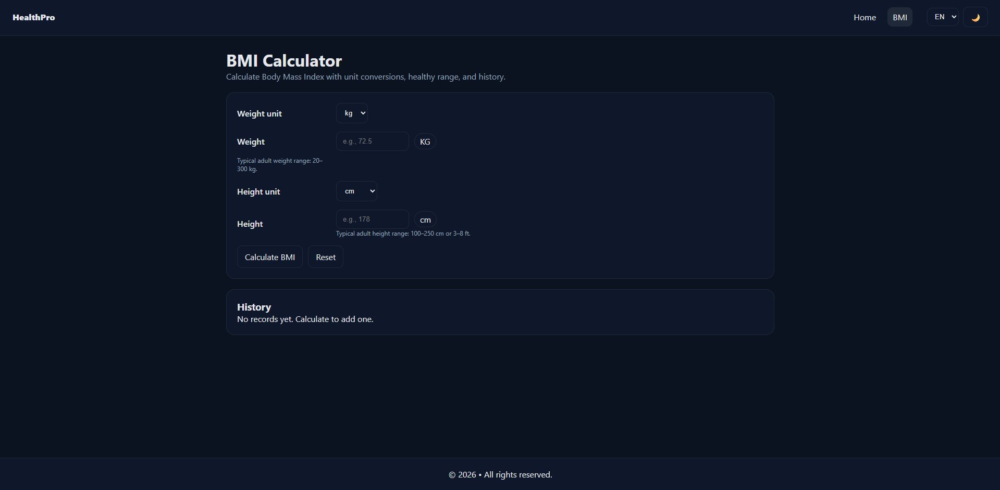

# BMI Calculator

A responsive React BMI calculator with metric and imperial units, English/Hindi UI, browser-local history, and CSV export.



## Features

- Calculate BMI with kg/cm or lb/ft + in inputs
- View an adult BMI category and its reference weight range
- Store up to 20 calculations in this browser, with delete and clear actions
- Export saved entries to CSV
- Switch between light/dark themes and English/Hindi
- Responsive navigation and GitHub Pages routing fallback

## BMI scope and data

This calculator uses standard adult BMI categories and is intended for adults aged 20 and older. BMI is a screening measure, not a diagnosis. Children and teens need age- and sex-specific BMI percentiles. [CDC adult BMI categories](https://www.cdc.gov/bmi/adult-calculator/bmi-categories.html)

Saved history and preferences stay in the browser's local storage; the app does not send them to a server. Clearing browser storage removes the saved history and preferences.

## Tech stack

React, Vite, React Router, Styled Components, Tolgee, and React Icons.

## Run locally

Use Node.js 20.19 or newer.

```bash
npm install
npm run dev
```

Create a production build with `npm run build`. Deploy to GitHub Pages with `npm run deploy`.

## Links

- Live: https://a2rp.github.io/bmi-calculator/
- Repository: https://github.com/a2rp/bmi-calculator
- Portfolio: https://www.ashishranjan.net/
- GitHub: https://github.com/a2rp
- CodePen: https://codepen.io/ash1198
- LinkedIn: https://www.linkedin.com/in/aashishranjan
- YouTube: https://www.youtube.com/@ashishranjan-ashz?sub_confirmation=1
- Email: mailto:ash.ranjan09@gmail.com

## Support

- Support: https://a2rp-donation-page.netlify.app/
- Buy Me a Coffee: https://buymeacoffee.com/a2rp
- Patreon: https://www.patreon.com/a2rp
